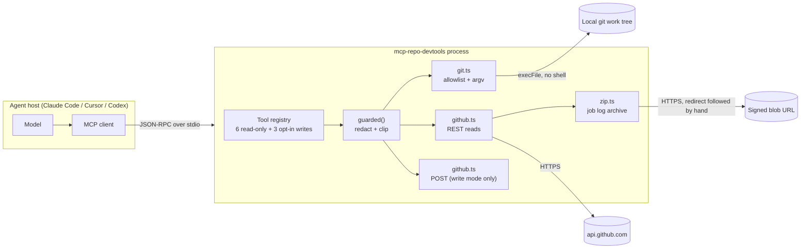

# Architecture

`mcp-repo-devtools` is a single stdio process that a coding agent starts. It
holds no state between calls, makes no network requests except to GitHub, and
never writes to a repository.

## Trust boundaries

| Boundary | Rule | Where |
| --- | --- | --- |
| Process → repository | Only 13 git subcommands; flag denylist stops `-c`, `--exec-path`, `--git-dir`; `execFile` with an argv array, never a shell string | `src/git.ts` |
| Repository path → filesystem | `realpath` the target and require `path.relative(root, target)` to stay inside `MCP_ALLOWED_ROOTS`; a filesystem root is refused as a root | `src/config.ts` |
| Process → GitHub | One base URL, one token, 15 s per call (30 s for a log download); redirects are followed manually so the token never reaches the blob host | `src/github.ts` |
| Caller → in-flight work | The request's abort signal is combined with the per-call timeout, never substituted for it, and reaches both `fetch` and `execFile`; a cancel is reported as `cancelled by the client` | `src/request-context.ts` |
| Result → model | The text passes `redact()` then `clip()` (64 KB / 200 lines); the structured copy passes `redactDeep()` and is validated against the tool's `outputSchema`, so a mismatch is an error rather than a quietly wrong field | `src/server.ts`, `src/text.ts` |
| Write tools | Registered only when `MCP_ENABLE_WRITE=1`, and each call logs a line to stderr | `src/server.ts` |
| Logs | stdout carries protocol frames only; every diagnostic goes to stderr | `src/index.ts` |

## Request lifecycle

1. The host calls a tool. The SDK validates the arguments against the zod schema
   before any of our code runs, so handlers can assume the shape.
2. Path-shaped arguments (`repo`) go through `assertAllowedRepo`; ref-shaped
   arguments (`ref`, `head`, `base`) go through `assertSafeRef`.
3. The handler does one unit of work: one git invocation, or one to four GitHub
   requests. Nothing is cached, so a second call always observes current state.
   If the client sent a `progressToken`, each GitHub hop emits one
   `notifications/progress` event (best effort — a lost notification never fails
   the call), and the caller's abort signal cancels the work in place.
4. The result is rendered as text, redacted, and clipped. Truncation is not
   silent: the tail line names the parameter that narrows the query. When the tool
   declared an `outputSchema`, the same data is also rendered as fields, deep-redacted
   and stripped of `undefined`, then validated by the SDK before it is sent.
5. Errors become `isError: true` results with a message that says what to do
   next ("set GITHUB_TOKEN", "narrow with path="), not a stack trace.

## Deliberate limits

- **No shell.** There is no tool that runs an arbitrary command, so prompt
  injection in a repository file cannot escalate to code execution.
- **No writes by default.** Six read tools are always registered; the three
  write tools are an explicit opt-in, because a read-only server is what makes
  this safe to point at any checkout.
- **No caching.** A stale answer about `git status` is worse than a slow one.
- **Log tails only.** `gh_ci_failures` returns the last N lines of a failing
  job, never the whole archive: a full Actions log is megabytes and would blow
  the model's context.

## Client-side capabilities

Three MCP features are used as seams rather than dependencies, and every one of them
degrades to the behaviour that existed before it:

| Feature | Used for | When the client lacks it |
| --- | --- | --- |
| `prompts` | three workflow plans a host can offer as commands | nothing is registered as a tool; tools/list is unchanged |
| `elicitation` | asking a human to approve a write | the write proceeds (or is refused, if `MCP_CONFIRM_WRITES=1`) |
| `sampling` | summarising an over-budget result | the result is clipped exactly as before |

The rule behind all three: a capability may improve a call, never widen what the server is
allowed to do. Elicitation adds a gate; it does not grant one. Sampling replaces a lossy
clip with a different lossy summary, and the summary passes the same redactor as the
original.

Confirmation sits in front of the handler, not inside it: the tool checks the outcome of
`requestWriteApproval` before it calls GitHub, so a declined write performs no request and
writes no audit line. A refusal is returned as `isError: true` with the human's note, which
is what lets a model try a different approach instead of retrying blindly.

## Adding a tool

1. Add the logic to `src/git.ts` or `src/github.ts` as a plain async function
   that takes validated arguments and returns a typed result.
2. If it returns bytes, decode them in a helper like `src/zip.ts` rather than
   inline in the handler.
3. Register it in `src/server.ts` with a description that says what it answers,
   not what it calls. Write tools belong inside the `if (writeEnabled)` block.
4. Add a test that stubs `fetch` (GitHub) or builds a temporary repository
   (git), plus one end-to-end case in `tests/server.test.ts` only if the wiring
   could plausibly break.
